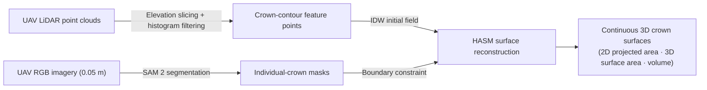

<div align="center">

# UAV_HASM_Tree

### Fine-Scale 3D Reconstruction of Individual-Tree Crowns by Integrating SAM 2 and HASM

**Maoyang He · Tianxiang Yue · Binggan Wei · Mingwei Zhao**


*Code and data for the paper.*

</div>

---

## Overview

This repository provides the code and data of a 3D individual-tree crown reconstruction framework that integrates **Segment Anything Model 2 (SAM 2)** with **High Accuracy Surface Modeling (HASM)**. SAM 2 extracts individual-tree crown boundaries from high-resolution UAV imagery (0.05 m spatial resolution) as 2D spatial constraints for HASM reconstruction. UAV LiDAR point clouds undergo elevation stratification and histogram filtering before HASM reconstructs continuous crown surfaces.

The experiments were conducted on the Huifeng Campus of Chuzhou University, Chuzhou, Anhui Province, China, where the dominant tree species include camphor tree, glossy privet, deodar cedar, and dawn redwood, and the shrub layer is dominated by red-tip photinia and boxwood.

## Workflow



The overall workflow consists of four main modules:

- **Module A — Individual-tree crown segmentation with SAM 2.** Multisource UAV data and SAM 2 are used for semantic segmentation and boundary extraction of individual-tree crowns. Three prompting strategies are provided: automatic full segmentation, point-based prompting, and text prompting. The manually delineated crowns in `label/` serve as the reference for accuracy evaluation.
- **Module B — Crown-contour feature-point extraction.** The point cloud of each individual tree is stratified along the Z-axis, where the decimal precision of the elevation values can be adjusted as needed to control the stratification; for each elevation layer, four extremal boundary points are identified in the corresponding 2D plane, and the points from all layers are integrated into an external crown skeleton without redundant interior points. Statistical filtering based on the elevation-frequency histogram then truncates the low-frequency regions of the histogram.
- **Module C — Surface reconstruction.** The extracted crown-contour feature points are used as observational control points; IDW provides the initial gridded surface, and the SAM 2 crown mask defines the spatial domain and constrains the crown boundary. The HASM governing equations are discretized with the finite-difference method and solved iteratively as a least-squares optimization problem. Conventional methods (TIN, Kriging, IDW) are implemented for comparison.
- **Module D — Evaluation.** Volume accuracy, surface-area characteristics, and adaptability are evaluated, following a "simulation validation–field application" strategy: algorithm performance is first quantified on simulated models with known reference geometry, followed by real-crown reconstruction experiments and batch geometric-parameter estimation.

## Repository Contents

### Study-area data and reference labels

| Path | Description |
|------|-------------|
| `remote sensing imagery and point clouds for the study area.png` | Imagery and point-cloud data of the study area (Huifeng Campus, Chuzhou University) |
| `label/` | Manually delineated individual-tree crowns (385 crowns vectorized by visual interpretation), used as reference data for accuracy assessment |

### Module A — Crown segmentation with SAM 2

| Path | Description |
|------|-------------|
| `SAM 2 automatic full segmentation code.ipynb` | Individual-tree crown segmentation with SAM 2 using automatic (prompt-free) inference |
| `SAM 2 point-based segmentation code.ipynb` | Individual-tree crown segmentation with SAM 2 using point prompts |
| `SAM 2 text-prompt code.ipynb` | Individual-tree crown segmentation with SAM 2 using text prompts |
| `Official SAM 2 link.txt` | Link to the official SAM 2 repository and model checkpoints |

### Module B — Crown-contour feature-point extraction

| Path | Description |
|------|-------------|
| `Histogram Point Cloud.ipynb` | Elevation-frequency histogram statistics of the point cloud, in which the low-frequency regions of the histogram are truncated |
| `Extraction of Contour Feature Points for Individual Trees.ipynb` | Contour feature-point extraction for a single tree crown based on elevation slicing (decimal precision adjustable as needed) |
| `Batch Extraction of Contour Feature Points from Multiple Tree Rings.ipynb` | Batch contour feature-point extraction from the elevation-layer contours of multiple trees (decimal precision adjustable as needed) |
| `Calculating removal rate.ipynb` | Statistics of the point-removal rate of the feature-extraction algorithm (mean overall removal rate of 36.06%) |

### Module C — Surface reconstruction and comparison

| Path | Description |
|------|-------------|
| `hasmprogram_Individual and batch HASM modeling/` | HASM program for individual-tree and batch crown surface reconstruction (run with manually delineated or SAM 2-derived masks as boundary constraints) |
| `Traditional and HASM modeling/` | Comparison of TIN, Kriging, IDW, and HASM crown-surface reconstruction; 2D projected area, 3D surface area, and volume computed with the 3D Analyst tools in ArcGIS |

### Module D — Simulation and evaluation

| Path | Description |
|------|-------------|
| `Simulate Original Points/` | Simulated original point clouds of the two reference crown models: a cone (base radius R = 2.5 m, height H = 5.0 m) representing a conifer crown and a paraboloid of revolution (R = 3.0 m, H = 4.0 m) representing a shrub crown, with random Gaussian noise added |
| `Simulation System + Software Copyright/` | Supporting 3D crown simulation system for automated processing and visualization of individual-tree crown data, together with its software copyright certificate |

## Usage

Following the "simulation validation–field application" strategy of the paper:

1. **Study-area data and reference labels** — UAV imagery (0.05 m) and LiDAR point clouds of the Huifeng Campus; manually delineated crowns in `label/`.
2. **Simulation validation** — reproduce the experiments on `Simulate Original Points/` (cone and paraboloid models with Gaussian noise) using the simulation system in `Simulation System + Software Copyright/`; compare HASM with IDW, Kriging, and TIN against the analytical surface-area and volume references.
3. **Crown segmentation with SAM 2** — run the three SAM 2 notebooks (inference was performed on Google Colab with an NVIDIA A100 GPU; morphological post-processing — opening, closing, and hole filling — refines the masks) and evaluate against `label/` (IoU 82.51%, area recall 87.20%).
4. **Crown-contour feature-point extraction** — `Histogram Point Cloud.ipynb` for histogram-based filtering of the point cloud, `Extraction of Contour Feature Points for Individual Trees.ipynb` (single tree) or `Batch Extraction of Contour Feature Points from Multiple Tree Rings.ipynb` (batch), and `Calculating removal rate.ipynb` for removal-rate statistics.
5. **Surface reconstruction and comparison** — run `hasmprogram_Individual and batch HASM modeling/` with manually delineated or SAM 2-derived masks as boundary constraints, and `Traditional and HASM modeling/` for the TIN/Kriging/IDW comparison.

## Key Results

| Experiment | Result |
|------------|--------|
| Numerical simulation (volume) | HASM was closest to the analytical reference values, with relative errors within 0.3% for both crown models (−0.12% for the tree model, −0.27% for the shrub model) |
| Contour feature extraction | Mean overall point-removal rate of 36.06% while retaining the geometric characteristics of the crowns |
| SAM 2 crown segmentation | IoU 82.51%, area recall 87.20%; 346 crowns retained after morphological post-processing |
| SAM 2 vs. manual boundaries (batch HASM) | Relative differences of −14.41% in 2D projected area, −26.29% in 3D surface area, and −20.97% in crown volume |

## Requirements

- SAM 2 inference was performed on the Google Colab cloud-computing platform with an NVIDIA A100 GPU; the official code and checkpoints are linked in `Official SAM 2 link.txt`.
- The HASM program in `hasmprogram_Individual and batch HASM modeling/` runs in MATLAB (R2016b).

## Citation

If you use this code or data, please cite:

```bibtex
@article{he2026hasm,
  title   = {Fine-Scale 3D Reconstruction of Individual-Tree Crowns by Integrating SAM 2 and HASM},
  author  = {He, Maoyang and Yue, Tianxiang and Wei, Binggan and Zhao, Mingwei},
  journal = {Ecological Informatics}
}
```

## Funding

This work was supported by the National Natural Science Foundation of China (42530108, 42330707).

## Acknowledgements

- SAM 2 (Ravi et al., 2025), released by Meta FAIR in 2024.
- HASM (High Accuracy Surface Modeling), developed on the basis of the fundamental theorem of surfaces (Yue et al.).

## Contact

Corresponding author: Prof. Tianxiang Yue ([yue@lreis.ac.cn](mailto:yue@lreis.ac.cn)) · Questions can also be raised via [issues](https://github.com/gisdance/UAV_HASM_Tree/issues).
