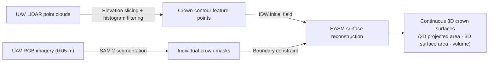

# UAV_HASM_Tree

### Fine-Scale 3D Reconstruction of Individual-Tree Crowns Using an Integrated SAM 2–HASM Framework

**Maoyang He · Tianxiang Yue · Binggan Wei · Mingwei Zhao**


-004088)

*Code and data for the manuscript submitted to **Remote Sensing** (MDPI).*

---

## Overview

This repository provides code and data for a 3D individual-tree crown reconstruction framework integrating **SAM 2** with **HASM**. SAM 2 extracts individual-tree crown boundaries from high-resolution UAV imagery (0.05 m) as 2D spatial constraints; UAV LiDAR point clouds undergo elevation stratification and histogram filtering before HASM reconstructs continuous crown surfaces.

Experiments were conducted on the Huifeng Campus of Chuzhou University, Chuzhou, Anhui, China — dominant species include camphor tree, glossy privet, deodar cedar, and dawn redwood; shrubs are mainly red-tip photinia and boxwood.

## Workflow



Four main modules:

- **Module A — Individual-tree crown segmentation with SAM 2.** Three prompting strategies: automatic full segmentation, point-based prompting, and text prompting. Manually delineated crowns in `label/` serve as accuracy-evaluation references.
- **Module B — Crown-contour feature-point extraction.** Point clouds stratified along Z-axis (adjustable decimal precision); four extremal boundary points per elevation layer form an external crown skeleton. Histogram-based statistical filtering truncates low-frequency regions.
- **Module C — Surface reconstruction.** Contour feature points act as control points; IDW gives the initial gridded surface; SAM 2 masks define the spatial domain. HASM equations are discretized via finite differences and solved iteratively as least-squares. TIN, Kriging, IDW implemented for comparison.
- **Module D — Evaluation.** Volume accuracy, surface-area characteristics, and adaptability, using a "simulation validation–field application" strategy.

## Repository Contents

### Study-area data and reference labels

| Path | Description |
|------|-------------|
| `remote sensing imagery and point clouds for the study area.png` | Imagery and point-cloud data of the study area |
| `label/` | 385 manually delineated crowns vectorized by visual interpretation, used as reference data |

### Module A — Crown segmentation with SAM 2

| Path | Description |
|------|-------------|
| `SAM 2 automatic full segmentation code.ipynb` | Prompt-free segmentation |
| `SAM 2 point-based segmentation code.ipynb` | Point-prompt segmentation |
| `SAM 2 text-prompt code.ipynb` | Text-prompt segmentation |
| `Official SAM 2 link.txt` | Official SAM 2 repository and checkpoints link |

### Module B — Crown-contour feature-point extraction

| Path | Description |
|------|-------------|
| `Histogram Point Cloud.ipynb` | Elevation-frequency histogram statistics with low-frequency truncation |
| `Extraction of Contour Feature Points for Individual Trees.ipynb` | Single-tree contour extraction via elevation slicing |
| `Batch Extraction of Contour Feature Points from Multiple Tree Rings.ipynb` | Batch extraction from elevation-layer contours |
| `Calculating removal rate.ipynb` | Point-removal-rate statistics (mean 36.06%) |

### Module C — Surface reconstruction and comparison

| Path | Description |
|------|-------------|
| `hasmprogram_Individual and batch HASM modeling/` | HASM program for individual/batch crown reconstruction (with manual or SAM 2 masks) |
| `Traditional and HASM modeling/` | TIN/Kriging/IDW/HASM comparison; areas and volume computed with ArcGIS 3D Analyst tools |

### Module D — Simulation and evaluation

| Path | Description |
|------|-------------|
| `Simulate Original Points/` | Simulated point clouds: cone (R = 2.5 m, H = 5.0 m, conifer) and paraboloid of revolution (R = 3.0 m, H = 4.0 m, shrub), with Gaussian noise |
| `Simulation System + Software Copyright/` | 3D crown simulation system plus its software copyright certificate |

## Usage

1. **Study-area data and reference labels** — UAV imagery, LiDAR point clouds, and `label/` crowns.
2. **Simulation validation** — reproduce experiments on `Simulate Original Points/` using the simulation system; compare HASM with IDW, Kriging, TIN against analytical references.
3. **Crown segmentation with SAM 2** — run the three notebooks (inference on Google Colab, NVIDIA A100; morphological post-processing: opening, closing, hole filling); evaluate against `label/` (IoU 82.52%, area recall 87.20%).
4. **Feature-point extraction** — histogram filtering, single-tree or batch extraction, removal-rate statistics.
5. **Surface reconstruction and comparison** — run the HASM program with manual or SAM 2 masks, plus the traditional-methods comparison.

## Key Results

| Experiment | Result |
|------------|--------|
| Numerical simulation (volume) | HASM closest to analytical references; relative errors within 0.3% (−0.12% tree, −0.27% shrub) |
| Contour feature extraction | Mean point-removal rate 36.06% while retaining crown geometry |
| SAM 2 crown segmentation | IoU 82.51%, area recall 87.20%; 346 crowns retained after post-processing |
| SAM 2 vs. manual boundaries (batch HASM) | Relative differences: −14.41% (2D area), −26.29% (3D surface area), −20.97% (volume) |

## Requirements

- SAM 2 inference on Google Colab with an NVIDIA A100 GPU; official code/checkpoints linked in `Official SAM 2 link.txt`.
- HASM program runs in MATLAB (R2016b).

## Citation

```bibtex
@Article{he2026hasm,
  author  = {He, Maoyang and Yue, Tianxiang and Wei, Binggan and Zhao, Mingwei},
  title   = {Fine-Scale 3D Reconstruction of Individual-Tree Crowns by Integrating SAM 2 and HASM},
  journal = {Remote Sensing},
  year    = {2026},
  note    = {Manuscript submitted to Remote Sensing (MDPI) for review}
}
```

## Funding

Supported by the National Natural Science Foundation of China (42530108, 42330707).

## Acknowledgements

- SAM 2 (Ravi et al., 2025), released by Meta FAIR in 2024.
- HASM, developed on the basis of the fundamental theorem of surfaces (Yue et al.).

## Contact

Corresponding author: Prof. Tianxiang Yue ([yue@lreis.ac.cn](mailto:yue@lreis.ac.cn)) · Questions via [issues](https://github.com/gisdance/UAV_HASM_Tree/issues).
