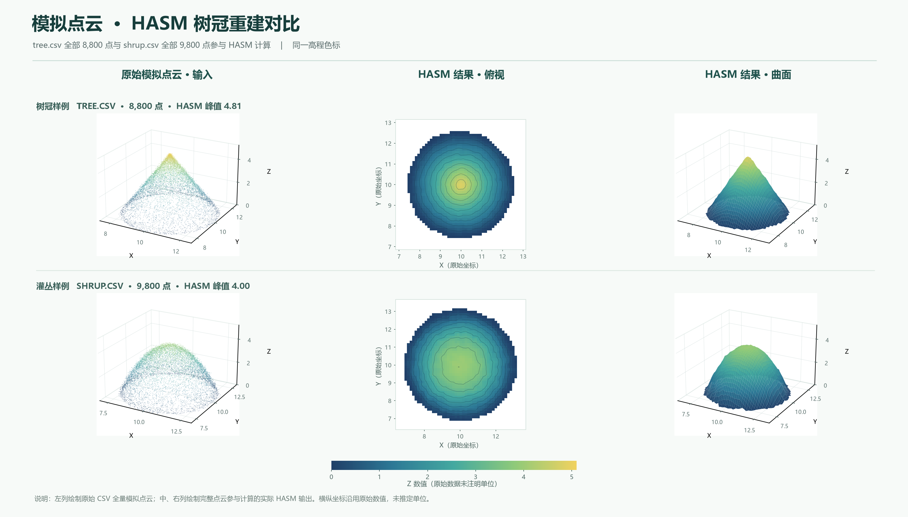

# HASM 树冠点云演示系统

这个工程把原 MATLAB HASM 界面复现为可运行的 R2016b 图形程序，并只保留两份指定的示例点云：`tree.csv` 和 `shrup.csv`。`shrup` 是原文件名，工程中保持原拼写。界面中的“示例”菜单可在两组数据及各自的栅格、预计算结果之间切换；默认打开 `tree.csv`。



## 目录

| 路径 | 内容 |
| --- | --- |
| `HASM_App.m` | 主界面及二维、三维绘图 |
| `HASM_Run.m`、`HASM_Read*.m`、`HASM_WriteGrid.m` | 输入、计算、输出接口 |
| `hasm.m` 等求解函数 | 原工程的 HASM 求解代码 |
| `data/tree.csv`、`data/shrup.csv` | 用户提供的原始 XYZ 数据，逐字节保留 |
| `data/*_initial.asc`、`data/*_mask.asc` | 为两份点云准备的初始曲面与有效区域 |
| `data/*_hasm_reference.asc` | 分别用完整的 8,800/9,800 点实际计算的预置结果 |
| `data/preparation_summary.json` | 栅格准备参数与源文件校验值 |
| `docs/preview_examples.png` | 两份完整点云及实际 HASM 输出的效果图 |
| `scripts/prepare_examples.py` | 由两份 CSV 重新生成初始栅格与掩膜 |
| `build_exe.m` | 编译 Windows EXE |

没有旧 `tree1`、旧模拟树冠、历史截图、编译缓存或运行结果。`dist/` 和 `results/` 已由 `.gitignore` 排除。

## 运行

需要 MATLAB R2016b 或兼容版本。打开工程根目录，在 MATLAB 命令窗口运行：

```matlab
HASM_App
```

启动后可直接点击下方按钮查看预计算的 HASM 结果。要换数据，点击“示例 → shrup.csv 灌木”或“示例 → tree.csv 树冠”。“读取原始点云xyz数据”会显示前 200 行，三维原始点云图使用完整 CSV。“点击进行HASM构建”会重新计算当前示例，默认将结果写到当前工作目录的 `results/`；可在“文件 → 设置结果文件”中改到可写位置。

两份 CSV 都是 `x,y,z` 三列，无缺失点。`tree.csv` 有 8,800 点，`shrup.csv` 有 9,800 点。重新构建会使用所选 CSV 的**全部点**，本机 51×51 示例栅格分别约需 15 秒和 19 秒。CSV 本身没有坐标系和单位元数据，图中的坐标与高程沿用原数值。它们来自模拟点云场景；不能把预置结果当作实测 LiDAR 精度验证。

## 从 CSV 准备 HASM 输入

原求解器除了点云，还需要同一坐标系、同一尺寸的 ArcGIS ASCII 初始栅格和掩膜。工程已带好两组输入，可直接运行。若要重生成：

```text
python scripts/prepare_examples.py
```

生成脚本只依赖 Python 标准库，用每组数据中的固定种子 1,200 点拟合一个简化径向初始表面，并从完整点云的 XY 凸包生成掩膜；**HASM 构建仍使用完整 CSV**。初始栅格在整个计算范围（包括掩膜外）都有有限高程；掩膜外像元使用 `-9999`。求解器完成后才应用掩膜。若使用自己的点云，需提供同坐标的初始栅格、掩膜，并在“文件”菜单选择三个输入文件。

## 编译 EXE

需要 MATLAB Compiler 许可。在工程根目录运行：

```matlab
build_exe
```

编译结果位于 `dist/HASM_App.exe`，并把 `data/` 打包进程序。目标 Windows 电脑还需安装 MATLAB Runtime 9.1（对应 R2016b）。EXE 可单独放到 GitHub Release，源码仓库不必提交 `dist/`。

## 上传 GitHub

把本文件夹作为仓库根目录，用 Git 或 GitHub Desktop 提交其中的文件；ZIP 仅便于传输、解压，不应作为唯一文件上传。`.gitignore` 排除了编译产物和个人运行结果。`.gitattributes` 在正常 `git add` 时将本机 GBK 的 MATLAB 源码转为仓库内 UTF-8，使中文可在 GitHub 阅读，并在检出时恢复本机编码。

```text
git init
git add .
git commit -m "Add HASM tree and shrup examples"
```

创建远端仓库后再添加其地址并推送；仓库 URL 需用你自己的实际地址。

本工程的 MATLAB 求解函数来自用户原有工程；当前仓库没有附加开源许可证。若将仓库设为公开，请由权利人确定发布权限和许可。

> R2016b 在本机的中文 Windows 环境中按 GBK 读取含中文文本的 `.m` 源码，因此 `HASM_App.m` 保存为 GBK；README 和 CSV 为 UTF-8 兼容文本。编辑 GUI 源码时请在编辑器中选择 GBK 编码。
